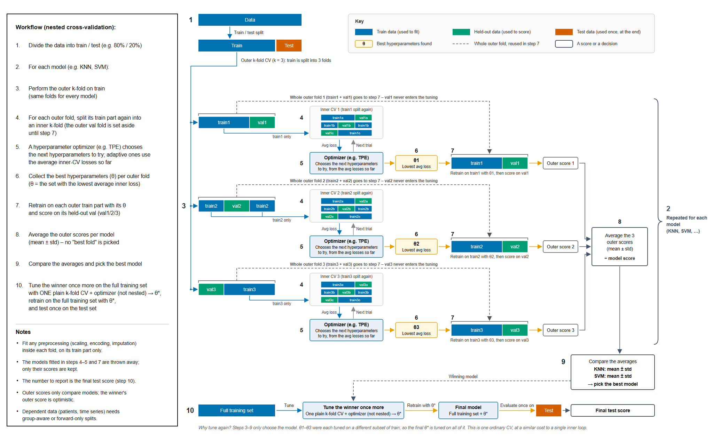

# An End-to-End Visual Guide to Nested Cross-Validation and Model Selection



A one-page figure that walks through nested cross-validation with model selection, step by step:
an outer k-fold loop to evaluate each model, an inner k-fold loop with a hyperparameter optimizer
(e.g. TPE) to tune it, a comparison across models, and a final tuning and test of the winner.

## Contents

| Path | Description |
| --- | --- |
| `figures/nested_cv_workflow.svg` | Editable vector figure (source) |
| `figures/nested_cv_workflow.pdf` | Vector PDF for slides and print |
| `figures/nested_cv_workflow.png` | Raster preview |
| `examples/nested_cv_example.py` | Runnable scikit-learn example that follows the figure's step numbers |

## Reading the figure

1. Split the data into train and test (e.g. 80% / 20%).
2. For each model (e.g. KNN, SVM), run steps 3-8.
3. Split train into outer k folds (the same folds for every model).
4. Split each outer train part into an inner k-fold.
5. A hyperparameter optimizer proposes hyperparameters. Adaptive ones (e.g. TPE) use the average inner-CV losses so far.
6. Keep the best hyperparameters (θ) per outer fold.
7. Retrain on each outer train part with its θ and score on its held-out fold.
8. Average the outer scores per model.
9. Compare the averages and pick the best model.
10. Tune the winner once more on the full training set with one plain k-fold CV, retrain, and test once on the test set.

Notes:

- Fit any preprocessing inside each fold, on its train part only.
- The number to report is the final test score (step 10). Outer scores only compare models; the winner's outer score is optimistic.
- Dependent data (e.g. patients, time series) needs group-aware or forward-only splits.

## Running the example

```bash
pip install scikit-learn scipy
python examples/nested_cv_example.py
```

The example uses a randomized search as the inner optimizer, which samples independently of earlier losses. Replace it with an adaptive method such as TPE (e.g. Optuna or hyperopt)
or any other hyperparameter optimization method without changing the structure.

## How to cite

Gross, A. (2026). *An End-to-End Visual Guide to Nested Cross-Validation and Model Selection* (Version 1.0.0) [Educational figure].
DOI: to be added after the first Zenodo release.

See also `CITATION.cff`.

## License

[CC BY-SA 4.0](https://creativecommons.org/licenses/by-sa/4.0/). You may share and adapt the figure,
including commercially, as long as you give credit and distribute adaptations under the same license.
The full text is in `LICENSE`.

## Feedback

Found an error or have a suggestion? Please open an issue.
